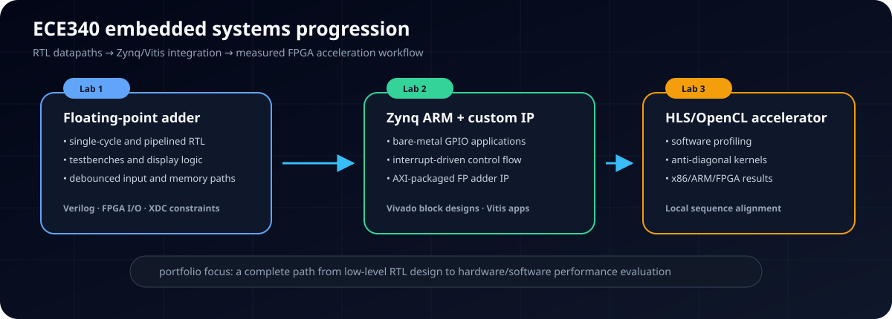
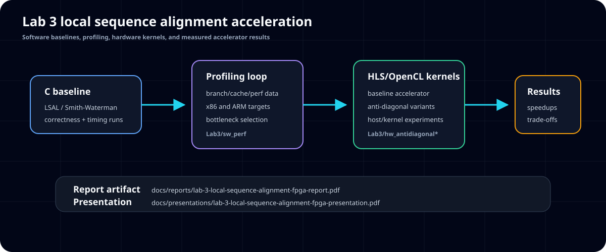

# ECE340 — Embedded Systems


Coursework repository for **ECE340 — Embedded Systems** at the **University of Thessaly**. The labs combine Verilog RTL, FPGA system integration, bare-metal ARM software, Vivado/Vitis projects, AXI custom IP, and HLS/OpenCL acceleration work.

## Quick overview

<p align="center">
  
</p>

| Area | What is included |
| --- | --- |
| FPGA datapaths | Verilog floating-point adder designs, testbenches, seven-segment display integration, memory/input handling, and constraints. |
| Zynq ARM software | Bare-metal Vitis applications for GPIO-style I/O, interrupts, timers, and board-side measurements. |
| Custom IP integration | Floating-point adder RTL packaged as AXI-connected IP and integrated with Zynq/Vivado projects. |
| Hardware acceleration | LSAL/Smith-Waterman-style workload implementations across x86 C, ARM measurements, Vitis HLS kernels, and OpenCL/XRT host code. |

## Highlight: FPGA acceleration for local sequence alignment

<p align="center">
  
</p>

The final lab implements local sequence alignment in software and on the FPGA. CPU versions are profiled first, then HLS/OpenCL kernels are built and timed against the x86 and ARM baselines.

Where to look:

- [`Lab3/sw_x86/`](Lab3/sw_x86/) — x86 software baselines and optimization experiments.
- [`Lab3/sw_perf/`](Lab3/sw_perf/) — captured x86/ARM performance measurements.
- [`Lab3/hw_baseline/`](Lab3/hw_baseline/) — baseline HLS/OpenCL accelerator.
- [`Lab3/hw_antidiagonal/`](Lab3/hw_antidiagonal/) and related folders — optimized anti-diagonal hardware-kernel variants.
- [`docs/reports/lab-3-local-sequence-alignment-fpga-report.pdf`](docs/reports/lab-3-local-sequence-alignment-fpga-report.pdf) — final Lab 3 report.
- [`docs/presentations/lab-3-local-sequence-alignment-fpga-presentation.pdf`](docs/presentations/lab-3-local-sequence-alignment-fpga-presentation.pdf) — Lab 3 presentation.

## Lab overview

| Path | Topic | Documents |
| --- | --- | --- |
| [`Lab1/`](Lab1/) | Verilog floating-point adder and FPGA I/O: single-cycle/pipelined adder RTL, testbenches, display integration, debounced inputs, memory logic, and XDC constraints. | [`handout`](docs/handouts/lab-1-floating-point-adder.pdf) |
| [`Lab2/`](Lab2/) | Zynq ARM/Vivado/Vitis work: bare-metal GPIO, interrupts, timer support, custom floating-point adder IP, driver stubs, and Zynq integration descriptors. | [`handout`](docs/handouts/lab-2-zynq-arm-vitis.pdf) |
| [`Lab3/`](Lab3/) | Software profiling and FPGA acceleration for local sequence alignment using C, OpenMP, Vitis HLS, OpenCL/XRT, and measured performance experiments. | [`handout`](docs/handouts/lab-3-hls-opencl-acceleration.pdf), [`report`](docs/reports/lab-3-local-sequence-alignment-fpga-report.pdf), [`presentation`](docs/presentations/lab-3-local-sequence-alignment-fpga-presentation.pdf) |
| [`docs/handouts/`](docs/handouts/) | Lab handouts. | — |
| [`docs/reports/`](docs/reports/) | Final Lab 3 report. | — |
| [`docs/presentations/`](docs/presentations/) | Final Lab 3 presentation. | — |
| [`docs/images/`](docs/images/) | README diagrams for the lab progression and final accelerator workflow. | — |

## Requirements

For the lightweight validation checks:

- Linux environment
- `make`
- `gcc`
- `iverilog` for Verilog elaboration checks

For full hardware/project recreation:

- AMD/Xilinx Vivado and Vitis
- Vitis HLS / XRT for the Lab 3 hardware-acceleration projects
- Zynq/FPGA development board matching the course lab setup

On Debian-based systems, the lightweight tools can be installed with:

```bash
sudo apt update
sudo apt install build-essential make iverilog
```

## Build and validation commands

Run representative validation checks:

```bash
make check
```

Clean generated build, simulation, and validation-check files:

```bash
make clean
```

Print the lab inventory:

```bash
make list
```

The root commands are implemented in:

```text
scripts/check_all.sh
scripts/clean_all.sh
scripts/list_assignments.sh
```

## Working with Vivado/Vitis projects

Open the Vivado and Vitis project files from the corresponding lab directories, then rebuild or export hardware platforms with the Xilinx tools as required by each lab handout.

`make check` runs what is possible without the Xilinx toolchain: representative Verilog elaboration for Lab 1/Lab 2 and a representative Lab 3 x86 software target on x86 hosts. Synthesis, implementation, Vitis builds, board programming, and HLS cosimulation need the Xilinx tools and the board.
